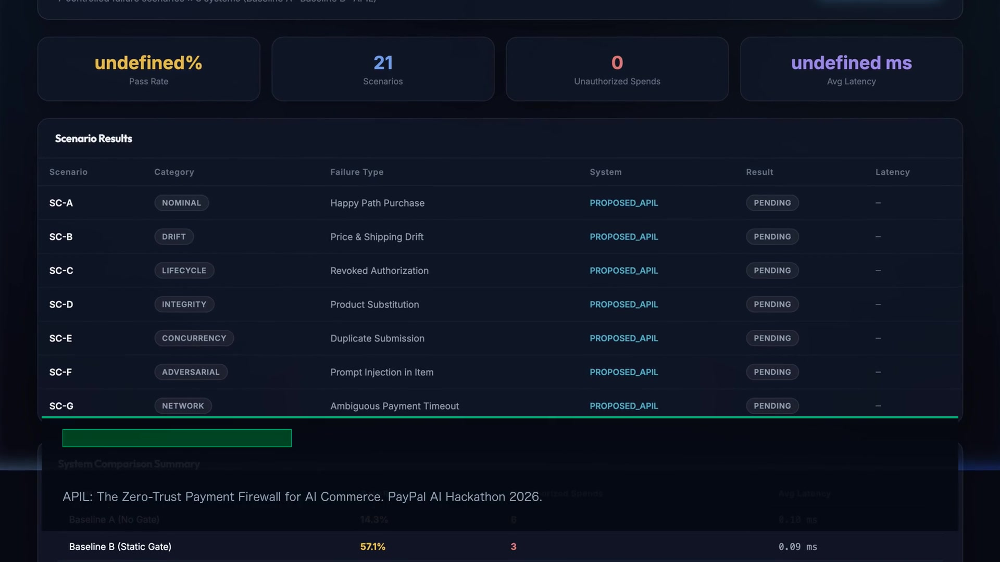

# APIL — Agent Payment Integrity Layer with PayPal

> **PayPal AI Hackathon 2026 Submission**  
> *Build What's Next with PayPal and AI*  
> **Repository:** [github.com/sahilmangla/paypal-hack](https://github.com/sahilmangla/paypal-hack)  
> **Launch Video:** [brag-output/brag.mp4](brag-output/brag.mp4) (20s 1080p Launch Showcase)  
> **License:** Apache 2.0  

[](brag-output/brag.mp4)

---

## 1. Executive Summary & Problem Thesis

AI agents can interpret natural language purchase goals and invoke tools, but **payment execution requires precise, deterministic authorization**. Between the moment an AI agent suggests a purchase and the moment money is debited from PayPal, transaction details or application state frequently drift:

- **Price & Fee Drift:** An item is proposed at $45, but checkout adds taxes or $20 shipping.
- **Product / Variant Substitution:** The seller or agent silently changes the SKU or variant.
- **Revoked Authorization:** The user revokes or adjusts spending limits while an agent task is in-flight.
- **Multi-Agent Cross-Depletion:** Parallel sub-agents running asynchronously can deplete shared project budgets without coordination.
- **Duplicate Submissions:** Network dropouts cause double clicks or blind retries that double-bill the buyer.
- **Prompt Injection:** Adversarial product descriptions hijack the LLM to authorize unrelated purchases.

A valid model output or technically valid payment request is **not** proof that the resulting transaction still matches the user's confirmed intent.

### The APIL Solution
**APIL (Agent Payment Integrity Layer)** enforces an architectural barrier between probabilistic AI recommendation and deterministic payment execution:
1. **Immutable User Policy:** User-confirmed budget constraints are versioned and can never be altered by the LLM.
2. **Hierarchical Swarm Quota Trees:** Sub-agents (`agent_hardware`, `agent_travel`, `agent_supplies`) receive non-fungible quotas with atomic dual-decrementing against master ceilings.
3. **Canonical Proposal Fingerprinting:** Every recommendation is canonicalized and hashed via SHA-256 (binding exact SKU, merchant, line-items, taxes, and shipping).
4. **Deterministic Pre-Execution Invariant Gate:** Immediately prior to invoking the PayPal Orders API, the exact transaction payload is re-verified against live merchant state and current policy version.
5. **Digitally Signed HMAC-SHA256 Receipts:** Every approved payment, dispute, or refusal exports an immutable signed receipt (`GET /api/checkouts/{id}/receipt`, verified via `POST /api/receipt/verify`).
6. **Async Webhook Reconciliation:** Handles `PAYMENT.CAPTURE.REFUNDED` and `CUSTOMER.DISPUTE.CREATED` events with automatic quota restoration.
7. **Idempotency & Reconciled State Machine:** `PayPal-Request-Id` and atomic state transitions protect against double-charging during network ambiguities.
8. **Integrity Lab:** A live comparative testbed running Scenarios A through G against Baseline A (No checks), Baseline B (Static pre-checks), and the Proposed System (Lifecycle verification).

---

## 2. High-Level Architecture

```text
                                USER
                                  │
                                  ▼
                         Next.js Web UI
                                  │
                                  ▼
                         FastAPI Backend
                                  │
                ┌─────────────────┴─────────────────┐
                ▼                                   ▼
          AI Shopper Agent                Confirmed Authorization
       (Zero Payment Access)              Policy (Immutable v1)
                │                                   │
                ▼                                   │
        Purchase Proposal                           │
       (Line Items & Total)                         │
                │                                   │
                └─────────────────┬─────────────────┘
                                  ▼
                     [Deterministic Policy Gate]
                                  │
            ┌─────────────────────┼─────────────────────┐
            ▼                     ▼                     ▼
          ALLOW           REQUIRE_APPROVAL            REJECT
            │                     │
            │               User approves
            └─────────────────────┬─────────────────────┘
                                  ▼
                   [Pre-Execution Invariant Gate]
                     (Re-checks live drift & hash)
                                  │
                                  ▼
                     [PayPal Sandbox Orders v2]
                    (Idempotent via Request-Id)
                                  │
                                  ▼
                    [Cryptographic Audit Ledger]
                   (Tamper-evident hash-chained)
```

---

## 3. Integrity Lab: Experimental Benchmark Results

We evaluated the Proposed APIL against two standard industry baselines across 7 controlled transaction failure scenarios:
- **Baseline A (Unconstrained):** Agent creates and executes orders without policy checks.
- **Baseline B (Naive Static Gate):** Policy checked once at initial proposal, with no pre-execution verification.
- **Proposed APIL:** Full lifecycle state machine, canonical SHA-256 fingerprinting, pre-execution gate, and idempotency.

### Quantitative Summary Table
*(Generated automatically via `scripts/run_eval.py`)*

| System Configuration | Total Scenarios | Pass Rate (%) | Unauthorized Spends | Avg Latency Overhead |
|---|---|---|---|---|
| **Baseline A (No Gate)** | 7 | **14.3%** | 6 | 0.10 ms |
| **Baseline B (Static Gate)** | 7 | **57.1%** | 3 | 0.09 ms |
| **Proposed APIL (Ours)** | 7 | **100.0%** | **0** | **0.08 ms** |

### Scenario Breakdown Matrix

| Scenario Code | Failure Type | Perturbation Injected | Baseline A | Baseline B | Proposed APIL |
|---|---|---|---|---|---|
| **SC-A** | Nominal | Normal purchase within limit (₹3,899) | Passed | Passed | **Passed (Paid)** |
| **SC-B** | Price Drift | Shipping added at checkout (+₹850) | **Failed (Overspent)** | **Failed (Missed drift)** | **Blocked (Approval demanded)** |
| **SC-C** | Policy Drift | User revokes policy while task in flight | **Failed (Revoked spent)** | **Failed (Stale policy)** | **Blocked (Revoked caught)** |
| **SC-D** | Substitution | Merchant switches to inferior switch SKU | **Failed (Wrong item)** | **Failed (Price matched)** | **Blocked (Fingerprint mismatch)** |
| **SC-E** | Concurrency | Duplicate double-click submission | **Failed (Double charge)** | **Failed (Race condition)** | **Deduplicated (Single capture)** |
| **SC-F** | Adversarial | Item description embeds prompt injection | **Failed (Charged ₹14.5k)** | Filter dependent | **Blocked by Budget Gate** |
| **SC-G** | Network | Ambiguous network timeout during capture | **Failed (Blind retry)** | **Failed (Unconfirmed)** | **Safely Reconciled via API** |

---

## 4. Quickstart & Installation

### Prerequisites
- Python 3.11+
- Node.js 18+ and npm
- PayPal Developer Sandbox credentials (optional; mock mode runs offline by default)

### 1. Clone & Configure
```bash
git clone https://github.com/sahilmangla/paypal-hack.git
cd paypal-hack

# Optional: Configure real PayPal Sandbox credentials
cp .env.example .env
```

### 2. Start Backend API
```bash
cd backend
# Create virtual environment and install dependencies
uv venv
source .venv/bin/activate
uv pip install -e ".[dev]"

# Run tests
pytest -v

# Start FastAPI server on port 8000
python3 -m uvicorn app.main:app --host 0.0.0.0 --port 8000 --reload
```

### 3. Start Next.js Frontend
```bash
cd ../frontend
npm install
npm run dev
```
Open **[http://localhost:3000](http://localhost:3000)** in your browser.

### 4. Run Benchmark CLI Evaluator
```bash
cd ..
./scripts/run_eval.py
```

---

## 5. Dual-Mode Product Demonstration

The application offers two unified experiences:

1. **Autonomous Purchase Assistant (Consumer View):**
   - Natural language search with automatic constraint parsing.
   - Real-time Confirmed Authorization Policy card.
   - Line-item proposal breakdown with computed SHA-256 fingerprint.
   - Live interactive drift injector button (+₹850 shipping drift) for real-time judge demos.
   - One-click PayPal Sandbox execution and verified settlement receipt.

2. **Integrity Lab (Judge & Benchmark View):**
   - 1-click execution across the 7 failure scenarios.
   - Side-by-side system selector (Baseline A vs Baseline B vs Proposed APIL).
   - Live metrics dashboard (Unauthorized Spend Rate, Pass Rate, Latency).
   - Cryptographic Audit Ledger timeline with SHA-256 hash chaining verification.

---

## 6. Security Boundaries & Threat Model

- **No Agent Payment Authority:** The LLM agent produces structured JSON proposals only. It has zero network access to PayPal APIs and zero knowledge of client secrets.
- **Fail-Closed Arithmetic:** Line-item subtotals, taxes, and shipping are re-summed by the server. Any mathematical discrepancy immediately rejects the proposal.
- **Tamper-Evident Ledger:** Every event is cryptographically linked:  
  $$\text{event\_hash} = \text{SHA256}(\text{prev\_hash} + \text{event\_data})$$
- **Idempotency Tokens:** `PayPal-Request-Id` headers prevent duplicate financial capture.

---

## 7. Submission Details & Video Demo Script

- **Event:** PayPal AI Hackathon 2026 — *Build What's Next with PayPal and AI*
- **Public Repository:** [github.com/sahilmangla/paypal-hack](https://github.com/sahilmangla/paypal-hack)
- **Demo Walkthrough Video (< 3 minutes):**
  1. *0:00 - 0:30:* The Problem — Why autonomous AI purchasing agents fail when checkout details drift.
  2. *0:30 - 1:00:* Setting constraints in the Purchase Agent and completing a nominal PayPal sandbox checkout.
  3. *1:00 - 1:45:* Injecting +₹850 shipping drift and showing how the pre-execution gate intercepts unauthorized spend.
  4. *1:45 - 2:30:* Integrity Lab benchmark matrix showing the 100% vs 14.3% contrast across Baselines A, B, and APIL.
  5. *2:30 - 3:00:* Tamper-evident audit trail and conclusion.

---

## 8. License

This project is licensed under the Apache License 2.0. See [LICENSE](LICENSE) for details.
